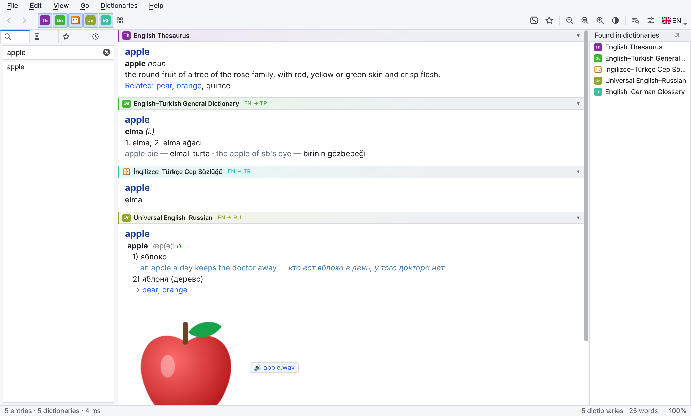
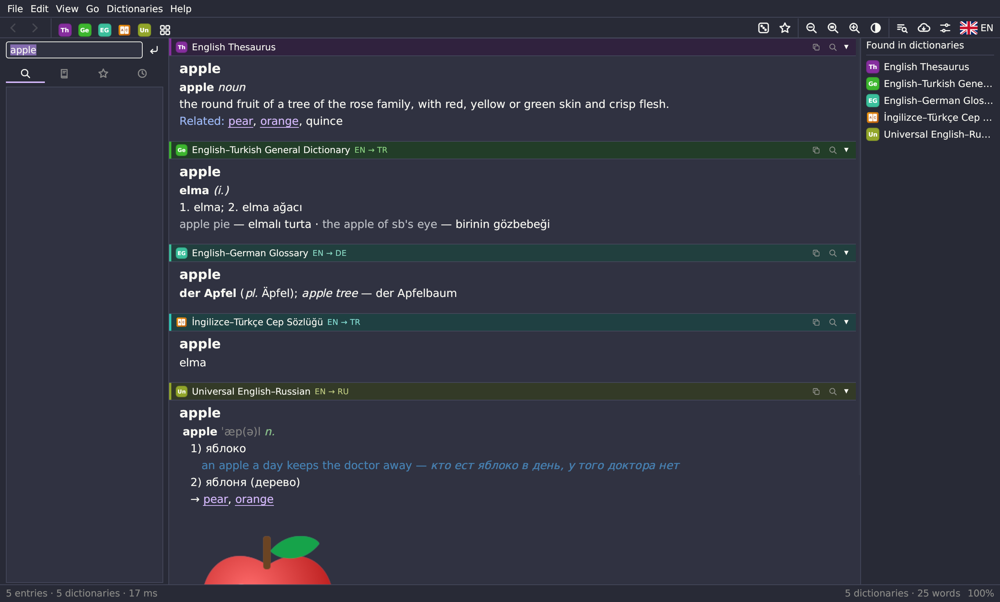
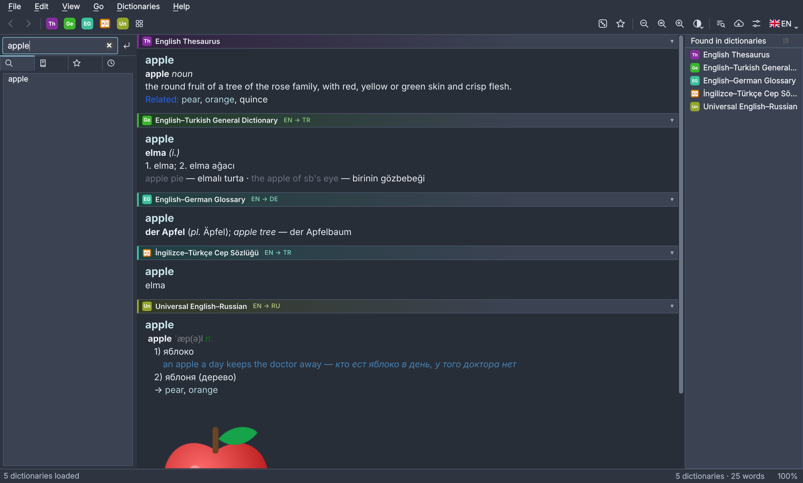

<div align="center">

# dictz

**Offline dictionary for Windows, Linux and macOS: a modern, GoldenDict-style desktop app with a full command line.**

[](https://pypi.org/project/dictz/)
[](https://crates.io/crates/dictz)
[](https://pypi.org/project/dictz/)
[](https://www.gnu.org/licenses/gpl-3.0)
[](https://github.com/bayramkotan/dictz/releases)
[](https://github.com/bayramkotan/dictz/releases)
[](https://pypi.org/project/dictz/)
[](https://github.com/bayramkotan/dictz)

StarDict · ABBYY Lingvo DSL · Babylon — many dictionaries, one search, no network.

[Screenshots](#screenshots) · [Install](#install) · [Quick start](#quick-start) · [Command line](#command-line-dictz--dct) · [Scan popup](#scan-popup-like-goldendict) · [Languages](#25-interface-languages) · [Settings](#settings) · [Türkçe](#türkçe)

<br>



<sub>Five dictionaries, one search. Every article is a card with the dictionary's own icon, colour, language pair and format; DSL pictures and sounds show inline.</sub>

</div>

---

## Two editions, one program

dictz comes in **two editions with the same features**. Both are released together from one tag with the same version number:

| | 🐍 Python edition | 🦀 Rust edition |
|---|---|---|
| Install | `pipx install dictz` / `pip install dictz` | `cargo install dictz` |
| Window | Qt (PySide6 + QtWebEngine) | egui: one native binary, no runtime |
| Portable builds | AppImage, Windows zip, macOS `.app` | `dictz-rs-*` single-file archives |
| Source | [`dictz/`](dictz/) | [`dictz-rs/`](dictz-rs/) ([README](dictz-rs/README.md)) |

Both read dictionaries identically, which CI checks against shared golden files. They also use **one data folder**, so dictionaries, history, favorites and settings added in one edition show up in the other. Either edition's command line can control either edition's window.

Both install two commands: **`dictz`** and its short name **`dct`**. They are the same program.

## Screenshots

<table>
<tr>
<td width="50%"><br><sub><b>Rust edition, dark theme</b> — one native binary, same features</sub></td>
<td width="50%"><br><sub><b>25 interface languages</b> — the flag at the top right</sub></td>
</tr>
<tr>
<td><br><sub><b>Scan popup</b> — copy a word anywhere (Ctrl+C+C)</sub></td>
<td><br><sub><b>Preferences</b> — 76 settings, searchable, per-setting reset</sub></td>
</tr>
<tr>
<td><br><sub><b>العربية</b> — Arabic, Persian and Urdu run right to left</sub></td>
<td><br><sub><b>Python edition, dark theme</b> — light, dark or follow the system</sub></td>
</tr>
</table>

<sub>The dictionaries in the pictures are small invented samples (`docs/screenshots/demo_dicts.py`); dictz ships no dictionary content.</sub>

## Highlights

- **Multi-format:** StarDict (`.ifo`), ABBYY Lingvo DSL (`.dsl`, `.dsl.dz`), Babylon (`.bgl`).
- **Multi-dictionary:** one query hits every dictionary, in your order.
- **Fast:** SQLite FTS5 index with Unicode, diacritic-insensitive search and as-you-type suggestions.
- **Fuzzy search:** "did you mean" suggestions when nothing matches, closest first.
- **Pictures and sounds:** DSL `[s]` media from `*.dsl.files/` or `*.dsl.files.zip`.
- **Dictionary icons and article cards:** each dictionary has its own icon (or a monogram badge in its own colour), its language pair (`EN → TR`) and format, in the articles, the dictionary bar and the lists. To give a dictionary your own icon, put `Name.png` / `.ico` / `.bmp` next to `Name.ifo` / `Name.dsl` / `Name.bgl`.
- **Scan popup:** copy a word in any program and its articles pop up next to the mouse. Also a tray icon, global hotkeys and a single running instance.
- **Modern window:**
  - tabs, back/forward, a dictionary bar and a "found in" panel
  - collapsible articles and find in page
  - favorites and history
  - light and dark themes, accent color, fonts and zoom
- **25 interface languages** with a flag picker at the top right: Türkçe, English, Azərbaycan türkcəsi, Deutsch, Français, Español, Italiano, Português, Nederlands, Polski, Русский, Українська, العربية, فارسی, اردو, Қазақша, Кыргызча, Oʻzbekcha, Türkmençe, 中文, 日本語, 한국어, Bahasa Indonesia, Bahasa Melayu, हिन्दी. Arabic, Persian and Urdu run right to left.
- **76 settings** in 9 pages with search and per-setting reset.
- **Full command line:** `dct lookup`, `dct add`, `dct config`, `dct doctor`, `dct update`, `dct shortcut` and more, with shell completion.
- **Offline and private:** no telemetry. The only network use is `dct update` / the update check, and only when you ask.
- **Portable:** each release ships standalone builds of both editions, and CI self-tests every build before publishing.

---

## Install

Pick your platform. Every method gives you both `dictz` and `dct`. Check the install with `dct doctor` and keep it current with `dct update`.

### 🐧 Linux

**Portable, no install** (from the [latest release](https://github.com/bayramkotan/dictz/releases/latest)):

```bash
# Python edition: AppImage (any distro)
chmod +x dictz-linux-x86_64.AppImage
./dictz-linux-x86_64.AppImage                 # window
./dictz-linux-x86_64.AppImage shortcut        # menu + desktop icon pointing at this AppImage

# Rust edition: one binary
tar xzf dictz-rs-linux-x86_64.tar.gz
./dictz-rs/dct shortcut                       # menu + desktop icon
sudo install dictz-rs/dictz /usr/local/bin/ && sudo ln -sf dictz /usr/local/bin/dct   # optional: on PATH
```

**From PyPI** (recommended: pipx keeps dictz in its own environment):

```bash
sudo apt install pipx            # Debian / Ubuntu / Mint   (Fedora: sudo dnf install pipx · Arch/CachyOS: sudo pacman -S python-pipx)
pipx ensurepath                  # once, then open a new terminal
pipx install dictz
dct -V
dct shortcut                     # application menu + desktop icon
```

Other ways that also work: a virtual environment (`python3 -m venv ~/.venvs/dictz && ~/.venvs/dictz/bin/pip install dictz`), `pip install --user dictz`, or a system install. `dct update` knows which one you used.

**From crates.io** (Rust edition):

```bash
sudo apt install build-essential pkg-config libasound2-dev   # Fedora: alsa-lib-devel · Arch: alsa-lib (already there)
cargo install dictz              # installs ~/.cargo/bin/dictz and ~/.cargo/bin/dct
dct shortcut
```

<details>
<summary>Linux notes</summary>

- **Python edition does not start: "xcb-cursor" error.** Qt 6 needs `libxcb-cursor0`: `sudo apt install libxcb-cursor0` (Fedora: `xcb-util-cursor`).
- **Wayland:** the window, the tray and the scan popup work. Wayland does not let programs grab global keys, so bind desktop shortcuts to `dct popup`, `dct show` or `dct watch toggle` instead (GNOME: Settings → Keyboard → Custom Shortcuts; KDE: System Settings → Shortcuts).
- **Selection scanning** ("look up the selected text", without copying) is a Linux X11 feature.
- The desktop icon is created as a trusted launcher (`gio set … metadata::trusted`). If your desktop still asks, right-click it and choose **Allow Launching**.
</details>

### 🪟 Windows 10 / 11

**Portable, no install** (from the [latest release](https://github.com/bayramkotan/dictz/releases/latest)):

1. Download `dictz-windows-x86_64.zip` (Python edition) or `dictz-rs-windows-x86_64.zip` (Rust edition).
2. Unzip it anywhere, for example `C:\Programs\dictz`, and run `dictz.exe`. `dct.exe` is the same program.
3. **Dosya → Masaüstü kısayolu oluştur** (or `.\dct.exe shortcut` in PowerShell) adds dictz to the Desktop and the Start menu.

The builds are unsigned: on first launch, click **More info → Run anyway** in SmartScreen.

**From PyPI** (PowerShell):

```powershell
winget install Python.Python.3.12        # if Python is not installed yet
py -m pip install --user pipx
py -m pipx ensurepath                    # then open a new terminal
pipx install dictz
dct -V
dct shortcut                             # Desktop + Start menu
```

If `dictz` / `dct` is "not recognized" after a plain `pip install dictz`, the Python *Scripts* folder is not on PATH. Use `py -m dictz …` (it works everywhere) or run `py -m pipx ensurepath`.

**From crates.io** (needs [Rust](https://rustup.rs) with the MSVC build tools):

```powershell
cargo install dictz                      # %USERPROFILE%\.cargo\bin\dictz.exe and dct.exe
dct shortcut
```

### 🍎 macOS

**Portable, Apple Silicon** (from the [latest release](https://github.com/bayramkotan/dictz/releases/latest)):

- Python edition: unzip `dictz-macos-arm64.zip`, move `dictz.app` to *Applications*, then **right-click → Open** the first time.
- Rust edition: `tar xzf dictz-rs-macos-arm64.tar.gz && ./dictz-rs/dct shortcut`. This creates `~/Applications/dictz.app` and a desktop link.

If macOS says the app "is damaged", remove the download quarantine with `xattr -dr com.apple.quarantine dictz.app`.

**From PyPI** (Apple Silicon and Intel):

```bash
brew install pipx && pipx ensurepath     # then open a new terminal
pipx install dictz
dct shortcut                             # ~/Applications/dictz.app (Launchpad, Spotlight) + desktop link
```

**From crates.io:** `cargo install dictz && dct shortcut`.

Global hotkeys on macOS need **System Settings → Privacy & Security → Accessibility** permission for dictz (or for your terminal, when started from one).

### From source

```bash
git clone https://github.com/bayramkotan/dictz.git && cd dictz
pip install -e ".[dev]"            # Python edition → dictz, dct
cd dictz-rs && cargo run --release # Rust edition
```

---

## Quick start

```bash
dct                                  # open the window
dct add ~/Sözlükler -r               # add a folder of dictionaries (any mix of formats)
dct lookup apple                     # print the articles in the terminal
dct shortcut                         # put dictz on the desktop and in the menu
dct update                           # get the newest version
```

Where to find dictionaries: [FreeDict](https://freedict.org/) (StarDict, many language pairs), [StarDict.org](http://download.huzheng.org/) (a large StarDict collection), and community [Lingvo DSL packs](http://lingvo.helpmax.net/).

---

## Command line (`dictz` / `dct`)

Both editions have the same commands, options and output. Without a command the window opens; `dct FILE…` opens it with those dictionaries. Help: `dct help`, `dct <command> --help`.

### The most used ones

| Command | What it does |
|---|---|
| `dct -V` | version. Every spelling works: `-v`, `-V`, `--version`, `--Version`, `--VERSION`, `-version`, `dct version` (`--json` for scripts) |
| `dct update` | updates **this** copy where it is installed (`--check` only looks, `--yes` skips the question) |
| `dct shortcut` | desktop + menu shortcut (`--desktop-only`, `--menu-only`, `--remove`) |
| `dct lookup WORD` | articles as text (`-d DICT`, `-p` prefix, `-f` fuzzy, `-n N`, `--json`, `--html`) |
| `dct add PATH… -r` | add dictionary files or whole folders |
| `dct doctor` | install kind, paths, index, history and a self-test |

`dct update` knows how it was installed: pip / pipx / venv / `--user` / system / editable / AppImage / portable (Python), and `cargo install` / portable binary (Rust).

### Everything

```bash
# look up
dct lookup apple              # alias: l
dct suggest app               # headwords starting with "app" (+ ≈ fuzzy fill)   alias: s
dct fuzzy aple                # "did you mean" candidates with scores           alias: f
dct random                    # a random article
dct shell                     # interactive prompt (:fuzzy, :suggest, :dicts, :random, :q)

# dictionaries
dct add ~/sozlukler -r        # --disabled, --reindex
dct dicts                     # position, on/off, name, format, words, path (--json, --names)   alias: ls
dct enable | disable | remove NAME     # names may be partial                                  alias: rm
dct move NAME top             # up / down / top / bottom / position
dct info NAME|FILE            # metadata
dct reindex [NAME…]           # rebuild the search index
dct scan FOLDER --add         # find dictionary files, add the new ones
dct dump NAME -F txt -o out.txt        # tsv / json / txt

# history, favorites, settings
dct history [--clear | --remove WORD]
dct favorites [list | add | remove | clear] [WORD…]          # alias: fav
dct config list               # every setting with value, range and description
dct config set search.fuzzy_cutoff 70
dct config get | reset | path | export FILE | import FILE

# install
dct paths                     # data folder, settings, databases
dct doctor                    # check the installation
dct selftest                  # headless self-test (exit 0 = OK)
dct update [--check] [--yes]  # alias: upgrade
dct shortcut [--remove]

# the running window
dct show                      # bring it to the front (starts dictz if needed)
dct popup [WORD]              # scan popup (no WORD = clipboard)
dct watch on|off|toggle|status         # clipboard / selection scanning
```

Global options: `--data-dir DIR` (or `DICTZ_DATA_DIR`), `--no-color` (or `NO_COLOR`).

### Shell completion

Completion works for both names, `dictz` and `dct`:

| Shell | Add to |
|---|---|
| bash | `~/.bashrc`: `eval "$(dct completion bash)"` |
| zsh | `~/.zshrc`: `eval "$(dct completion zsh)"` |
| fish | `dct completion fish > ~/.config/fish/completions/dct.fish` |
| PowerShell | `$PROFILE`: `dct completion powershell \| Out-String \| Invoke-Expression` |

---

## Scan popup (like GoldenDict)

Turn on **Tarama** in the toolbar (or run `dct watch on`, or press Ctrl+F12). Then, in any program, do one of these:

- select a word and press **Ctrl+C twice** quickly (Ctrl+C+C);
- with "Her kopyalamada ara" on, copy it once;
- on Linux X11 with "Seçilen metni ara" on, just select it with the mouse.

A small window with the articles opens next to the mouse:

- 📌 keeps it open.
- ⤢ opens the word in the main window.
- Esc, or moving the mouse away, closes it.

dictz keeps running in the **tray** when "Kapatınca tepsiye gizle" is on.

Global hotkeys (you can change them in Tercihler → Genel kısayollar):

| Key | Action |
|---|---|
| Ctrl+F11 | show / hide the window |
| Ctrl+F12 | scanning on / off |
| Ctrl+Shift+F11 | look up the clipboard |

They work on Windows, macOS and Linux X11. On Wayland, use desktop shortcuts running `dct show`, `dct watch toggle` and `dct popup` instead.

---

## 25 interface languages

Click the flag at the top right of the window (or Tercihler → Genel → Arayüz dili, or `dct config set general.language de`). **Otomatik** follows the system language.

| | | | | |
|---|---|---|---|---|
| 🇹🇷 Türkçe | 🇬🇧 English | 🇦🇿 Azərbaycan türkcəsi | 🇩🇪 Deutsch | 🇫🇷 Français |
| 🇪🇸 Español | 🇮🇹 Italiano | 🇵🇹 Português | 🇳🇱 Nederlands | 🇵🇱 Polski |
| 🇷🇺 Русский | 🇺🇦 Українська | 🇸🇦 العربية | 🇮🇷 فارسی | 🇵🇰 اردو |
| 🇰🇿 Қазақша | 🇰🇬 Кыргызча | 🇺🇿 Oʻzbekcha | 🇹🇲 Türkmençe | 🇨🇳 中文 |
| 🇯🇵 日本語 | 🇰🇷 한국어 | 🇮🇩 Bahasa Indonesia | 🇲🇾 Bahasa Melayu | 🇮🇳 हिन्दी |

Every menu, button, message and setting is translated, in both editions. Arabic, Persian and Urdu are laid out right to left. Corrections are welcome: the catalogues are plain JSON in [`dictz/resources/i18n/`](dictz/resources/i18n/), and a test fails if any text is missing in any language.

## Dictionary icons

Every dictionary has a face: its own icon if it has one, otherwise a monogram badge in a colour that stays the same everywhere.

- Put `Name.png` (or `.ico`, `.bmp`, `.jpg`, `.gif`) next to `Name.ifo` / `Name.dsl` / `Name.bgl` to give a dictionary your own icon, as in GoldenDict.
- Babylon `.bgl` files bring their icon inside the file.
- The language pair (`EN → TR`) comes from the dictionary itself, or from its name (`En2Tr`, `English-Turkish`, `İngilizce → Türkçe`).

## Settings

**Düzen → Tercihler** (Ctrl+,) or `dct config`. There are 76 settings, stored in `settings.json` in the data folder and shared by both editions:

| Page | Examples |
|---|---|
| Genel | interface language, restore tabs / last search, check updates on start, confirm quit, remember window, always on top, load in background, tray icon, close to tray, start in tray, single instance |
| Görünüm | theme, accent color, UI font and size, toolbar / dictionary bar / found-in / sidebar / status bar, sidebar side, tab title length |
| Makale | font, size, line spacing, headword size, zoom, max width, dictionary headers, open collapsed, pictures, picture height, find highlight color |
| Arama | live search, delay, minimum letters, suggestion count, prefix fallback, fuzzy on/off / threshold / count, max articles, Enter → new tab, ignore case |
| Tarama penceresi | scanning on/off, Ctrl+C+C, every copy, selection (Linux), Ctrl+C+C interval, max text length, open near the mouse, always on top, hide when the mouse leaves + delay, size, record in history |
| Genel kısayollar | on/off, show/hide main window, scanning on/off, look up the clipboard |
| Sözlükler | dictionary folders scanned on start, recursive, reindex changed files |
| Ses | auto-play, volume, system player |
| Geçmiş ve Favoriler | history on/off, sidebar counts, database limit, clear on exit |

The window also has:

- a search box over all settings
- ↺ to reset a single setting, plus page reset and reset all
- a Shortcuts page
- an Advanced page: data folder, rebuild indexes, check updates, clear history / favorites, export / import

## Where dictz keeps its files

`dct paths` prints them. By default:

| Platform | Data folder |
|---|---|
| Linux | `~/.local/share/dictz` (or `$XDG_DATA_HOME/dictz`) |
| Windows | `%APPDATA%\dictz` |
| macOS | `~/Library/Application Support/dictz` |

To use another folder, pass `--data-dir DIR` or set `DICTZ_DATA_DIR`. A USB stick works too.

| File | What is in it |
|---|---|
| `dictionaries.json` | your dictionary list: order, on/off, names (a dictionary is known by its file path; a second one with the same name is shown as `Name (2)`) |
| `articles/<id>.db` | each dictionary's articles, saved once when it is added, so dictz starts at once (rebuilt by itself when the file changes) |
| `settings.json` | the 76 settings |
| `dictz_index.db` | the headword index (SQLite FTS5) |
| `dictz_history.db` | history and favorites |

All of them are shared by the Python and the Rust edition.

## Supported formats

| Format | Extension | Python edition | Rust edition |
|--------|-----------|----------------|--------------|
| StarDict | `.ifo` / `.idx` / `.dict(.dz)` | native | native |
| ABBYY Lingvo DSL | `.dsl` / `.dsl.dz` | [PyGlossary](https://github.com/ilius/pyglossary) | native (port of PyGlossary's reader) |
| Babylon | `.bgl` | [PyGlossary](https://github.com/ilius/pyglossary) | native (port of PyGlossary's reader) |

More formats (XDXF, Slob, DictD, MDict) are on the [TODO](TODO.md).

## Keyboard shortcuts

These are the same in both editions (Yardım → Kısayollar, F1):

| Shortcut | Action |
|---|---|
| Ctrl+F | Arama kutusuna odaklan |
| Enter | Ara (sonuç yoksa “Bunu mu demek istediniz?”) |
| Ctrl+Enter | Yeni sekmede ara |
| Ctrl+T / Ctrl+W | Yeni sekme / sekmeyi kapat |
| Ctrl+Tab / Ctrl+Shift+Tab | Sonraki / önceki sekme |
| Alt+← / Alt+→ | Geri / ileri |
| Ctrl+R | Rastgele kelime |
| Ctrl+D | Favorilere ekle / çıkar |
| Ctrl+Shift+C | Kelimeyi kopyala |
| Ctrl+Shift+A | Makaleyi metin olarak kopyala |
| Ctrl+S | Makaleyi HTML olarak kaydet |
| Ctrl+Shift+F | Sayfada bul |
| F3 / Shift+F3 | Sonraki / önceki eşleşme |
| Ctrl+= / Ctrl+- / Ctrl+0 | Büyüt / küçült / sıfırla |
| Ctrl+B | Yan paneli göster/gizle |
| F11 | Tam ekran |
| Ctrl+O / Ctrl+Shift+O | Sözlük ekle / klasör ekle |
| Ctrl+M | Sözlük yöneticisi |
| Ctrl+, | Tercihler |
| Ctrl+Q | Çıkış |

## Build and develop

```bash
pip install -e ".[dev]" && pytest -v       # Python edition
cd dictz-rs && cargo test                  # Rust edition (incl. parity tests)
python tests/data/parity/make_samples.py   # regenerate parity samples + golden files
bash scripts/build.sh                      # portable builds (Windows: scripts\build.ps1)
```

See [`docs/PACKAGING.md`](docs/PACKAGING.md) for details. CI builds, self-tests and publishes everything on each `v*` tag.

## License

[GNU General Public License v3.0 or later](LICENSE) · [Bayram Kotan](https://bayramkotan.com) · [github.com/bayramkotan](https://github.com/bayramkotan)

---

## Türkçe


dictz; Windows, Linux ve macOS için çevrimdışı çalışan, çoklu format destekli, GoldenDict tarzı modern bir sözlük uygulamasıdır. **Python** ve **Rust** olmak üzere iki sürümü vardır. İkisinin özellikleri ve sürüm numarası aynıdır, veri klasörünü de paylaşırlar: sözlükler, geçmiş, favoriler ve ayarlar ortaktır. İki sürüm de **`dictz`** ve kısa adı **`dct`** komutlarını kurar; ikisi aynı programdır.

### Kurulum

| Platform | Portable (kurulumsuz) | Paket yöneticisi |
|---|---|---|
| **Linux** | `dictz-linux-x86_64.AppImage` → `chmod +x` ve çalıştır · Rust: `dictz-rs-linux-x86_64.tar.gz` | `pipx install dictz` · `cargo install dictz` |
| **Windows 10/11** | `dictz-windows-x86_64.zip` veya `dictz-rs-windows-x86_64.zip` → aç, `dictz.exe` | `pipx install dictz` · `cargo install dictz` |
| **macOS** | `dictz-macos-arm64.zip` → `dictz.app` (ilk açılışta sağ tık → Aç) · Rust: `dictz-rs-macos-arm64.tar.gz` | `pipx install dictz` (Intel dahil) · `cargo install dictz` |

Hepsi [Releases](https://github.com/bayramkotan/dictz/releases/latest) sayfasında. Kurulumdan sonra:

```bash
dct -V            # sürüm (-v, -V, --version, --Version, -version… hepsi çalışır)
dct shortcut      # masaüstü + menü kısayolu (Windows: Masaüstü + Başlat, macOS: ~/Applications/dictz.app)
dct update        # kurulduğu yerde günceller (pip / pipx / venv / AppImage / portable / cargo)
dct doctor        # kurulumu kontrol et
```

Pencerede de aynı işlem var: **Dosya → Masaüstü kısayolu oluştur**.

- Windows'ta `dct` "tanınmıyor" diyorsa Python *Scripts* klasörü PATH'te değildir. `py -m dictz …` her yerde çalışır; kalıcı çözüm için `py -m pipx ensurepath`.
- Linux'ta Python sürümü "xcb-cursor" hatası verirse `sudo apt install libxcb-cursor0` kurun.
- Wayland'da genel kısayollar yerine masaüstü kısayollarını `dct popup`, `dct show` ve `dct watch toggle` komutlarına bağlayın.

### Öne çıkanlar

- **Çoklu format:** StarDict, DSL, Babylon.
- **Çoklu sözlük:** tek arama hepsinde çalışır.
- **Hızlı:** SQLite FTS5 ve diakritik duyarsız arama.
- **Bulanık arama:** sonuç yoksa "Bunu mu demek istediniz?" önerileri.
- **Resim ve ses:** DSL `[s]` dosyaları.
- **Çevrimdışı:** telemetri yok.
- **Tarama penceresi:** herhangi bir programda Ctrl+C+C, her kopyalama ya da Linux'ta yalnızca seçmek, makaleyi imlecin yanında açar. Ayrıca tepsi simgesi, genel kısayollar ve tek kopya çalışma.
- **25 arayüz dili:** pencerenin sağ üstündeki bayraktan seçilir (Türkçe, English, Azərbaycan türkcəsi, Deutsch, Русский, العربية, فارسی, 中文, 日本語…). Arapça, Farsça ve Urduca sağdan sola.
- **Ayarlar:** 9 sayfada 76 ayar, arama kutusu ve ayar başına sıfırlama.
- **Tam komut satırı:** iki sürümde aynıdır (`dct help`), kabuk tamamlama hem `dictz` hem `dct` için çalışır.

### Lisans

[GNU General Public License v3.0 veya sonrası](LICENSE).
