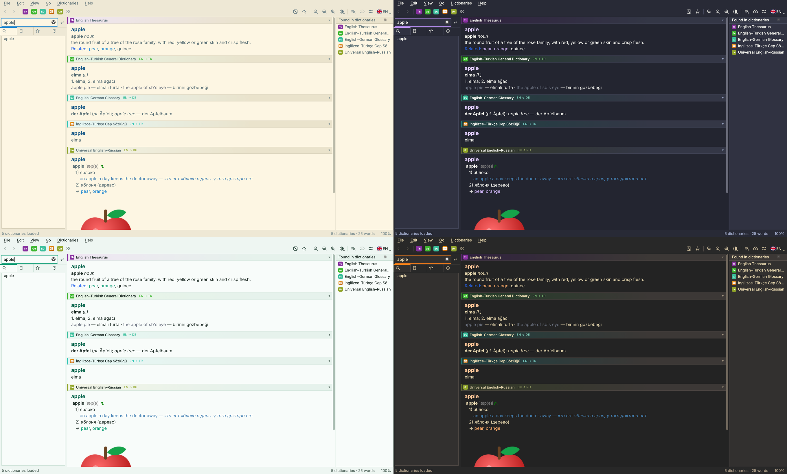
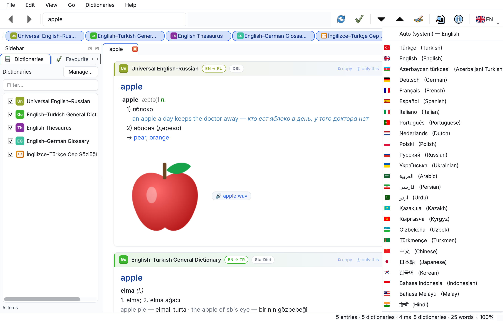
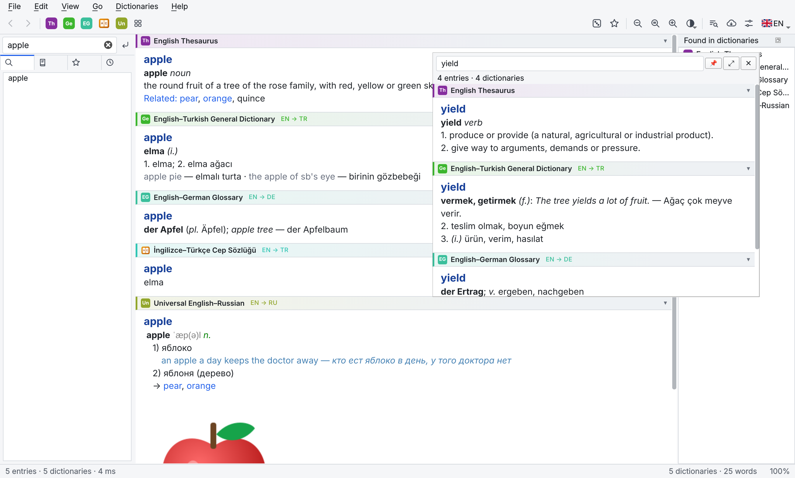
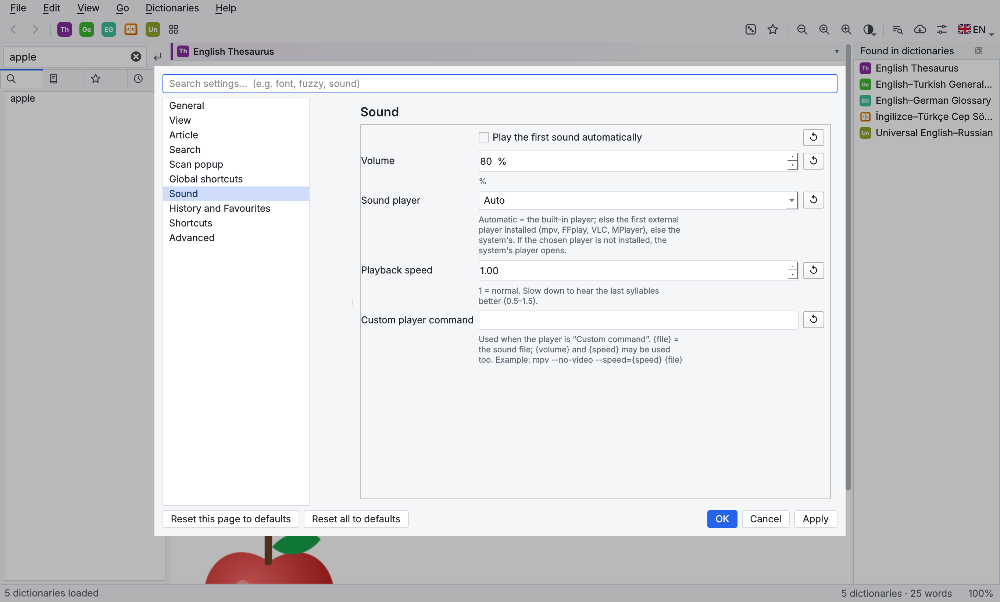
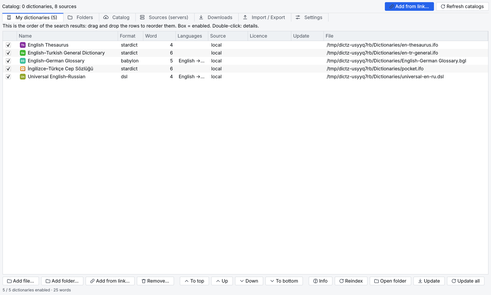
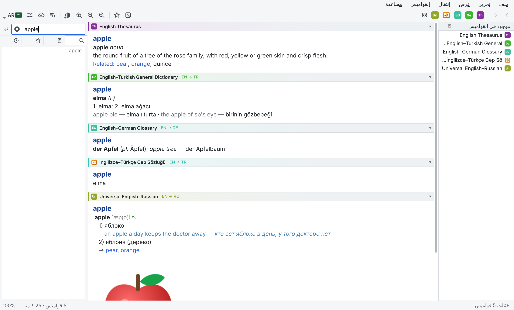
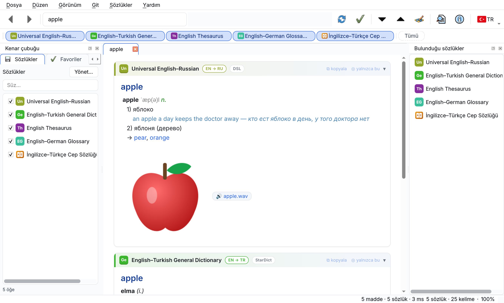

<div align="center">

# dictz

**Offline dictionary for Windows, Linux and macOS: a modern, GoldenDict-style desktop app with a full command line.**

[](https://pypi.org/project/dictz/)
[](https://crates.io/crates/dictz)
[](https://pypi.org/project/dictz/)
[](https://www.gnu.org/licenses/gpl-3.0)
[](https://github.com/bayramkotan/dictz/releases)
[](https://github.com/bayramkotan/dictz/releases)
[](https://pypi.org/project/dictz/)
[](https://github.com/bayramkotan/dictz)

StarDict · ABBYY Lingvo DSL · Babylon — many dictionaries, one search, no network.

[Screenshots](#screenshots) · [Install](#install) · [Quick start](#quick-start) · [Command line](#command-line-dictz--dct) · [Scan popup](#scan-popup-like-goldendict) · [Languages](#25-interface-languages) · [Settings](#settings) · [Türkçe](#türkçe)

<br>


<sub>Five dictionaries, one search, in a compact GoldenDict-like window: the search box and word list on the left, the dictionary bar as small icons on top, every article under a thin strip with the dictionary's icon, colour and language pair; DSL pictures and sounds show inline.</sub>

</div>

---

## Two editions, one program

dictz comes in **two editions with the same features**. Both are released together from one tag with the same version number:

| | 🐍 Python edition | 🦀 Rust edition |
|---|---|---|
| Install | `pipx install dictz` / `pip install dictz` | `cargo install dictz` |
| Window | Qt (PySide6 + QtWebEngine) | egui: one native binary, no runtime |
| Portable builds | AppImage, Windows zip, macOS `.app` | `dictz-rs-*` single-file archives |
| Source | [`dictz/`](dictz/) | [`dictz-rs/`](dictz-rs/) ([README](dictz-rs/README.md)) |

Both read dictionaries identically, which CI checks against shared golden files. They also use **one data folder**, so dictionaries, history, favorites and settings added in one edition show up in the other. Either edition's command line can control either edition's window.

Both install two commands: **`dictz`** and its short name **`dct`**. They are the same program.

**On the phone:** dictz Mobile (Android, iOS) is a separate app on the same Rust core, coming as a paid app; it is not part of this repository.

## Screenshots

<table>
<tr>
<td width="50%"><br><sub><b>Rust edition, Dracula theme</b> — one native binary, same features</sub></td>
<td width="50%"><br><sub><b>Python edition, Nord theme</b> — 27 themes, or follow the system</sub></td>
</tr>
<tr>
<td><br><sub><b>Themes</b> — Solarized Light, Dracula, Mint, Gruvbox Dark …</sub></td>
<td><br><sub><b>25 interface languages</b> — the flag at the top right</sub></td>
</tr>
<tr>
<td><br><sub><b>Scan popup</b> — copy a word anywhere (Ctrl+C+C)</sub></td>
<td><br><sub><b>Preferences → Sound</b> — pick the player (built-in, mpv, FFplay, VLC, MPlayer, system, own command) and the speed</sub></td>
</tr>
<tr>
<td><br><sub><b>Dictionaries</b> — your list in search order, folders, catalog, sources, downloads</sub></td>
<td><br><sub><b>العربية</b> — Arabic, Persian and Urdu run right to left</sub></td>
</tr>
</table>

<sub>The dictionaries in the pictures are small invented samples (`docs/screenshots/demo_dicts.py`); dictz ships no dictionary content. `docs/screenshots/shoot.py` (Python edition, no display needed) and `shoot_rust.sh` (Rust edition, under Xvfb) take all these pictures again.</sub>

## Highlights

- **Multi-format:** StarDict (`.ifo`, with its `.syn` synonyms: *went* finds *go*), ABBYY Lingvo DSL (`.dsl`, `.dsl.dz`), Babylon (`.bgl`).
- **Multi-dictionary:** one query hits every dictionary, in your order.
- **Fast:** SQLite FTS5 index with Unicode, diacritic-insensitive search and as-you-type suggestions.
- **Fuzzy search:** "did you mean" suggestions when nothing matches, closest first. Suggestions are worked out on their own thread, so typing never freezes, even with dozens of dictionaries and millions of headwords.
- **Pictures and sounds:** DSL `[s]` media (sounds `.wav` — ADPCM too — `.mp3`, `.ogg`, `.spx`, `.opus`, `.flac`, `.m4a`, `.aac`, `.wma`; pictures `.png`, `.jpg`, `.gif`, `.bmp`, `.tif`, `.webp`; extensions in any letter case) and StarDict `res/`, found under every name GoldenDict uses — `X.dsl.dz.files.zip`, `X.dsl.files.zip`, `X.files.zip` or the same as folders, in any letter case. Sounds play to the very end (a short silence is added so the last syllable is never cut), at the speed you choose (0.5–1.5×), with the player you pick in **Tercihler → Ses**: built-in, mpv, FFplay, VLC, MPlayer, the system's, or a command of your own — as in GoldenDict, just typing a program (e.g. `mplayer`) into *Özel oynatıcı komutu* is enough. On Linux *Otomatik* uses an installed mpv / FFplay / VLC / MPlayer first (they play through PipeWire / PulseAudio). Players that are not installed are marked in the list, and the status bar says when a player is missing or cannot play a file; replay / stop sit in the status bar.
- **Compact, GoldenDict-like window:** search box (always on top of the left pane, with an Enter button ⏎) and word list in the left pane (with Dictionaries, Favourites and History as icon tabs), one toolbar row with the dictionary bar as small toggles, thin article headers, no tab row while there is one tab, dictz's own line icons, and an **interface scale** setting (50–250 %) for high-resolution screens.
- **Dictionary icons:** each dictionary has its own icon (or a monogram badge in its own colour), its language pair (`EN → TR`) and format, in the articles, the dictionary bar and the lists. To give a dictionary your own icon, put `Name.png` / `.ico` / `.bmp` next to `Name.ifo` / `Name.dsl` / `Name.bgl`.
- **Scan popup:** copy a word in any program and its articles pop up next to the mouse. Also a tray icon, global hotkeys and a single running instance.
- **Modern window:**
  - tabs, back/forward, a dictionary bar and a "found in" panel
  - collapsible articles and find in page
  - favorites and history
  - **27 themes** (Otomatik, Açık, Koyu, Sepya, Solarized, Gruvbox, GitHub, Catppuccin, Rosé Pine, Nord, One, Nane, Lavanta, Dracula, Monokai, Tokyo Night, Everforest, Gece mavisi, Gece siyahı, high contrast…) from Görünüm → Tema or the toolbar's theme button; accent color, fonts and zoom
- **25 interface languages** with a flag picker at the top right: Türkçe, English, Azərbaycan türkcəsi, Deutsch, Français, Español, Italiano, Português, Nederlands, Polski, Русский, Українська, العربية, فارسی, اردو, Қазақша, Кыргызча, Oʻzbekcha, Türkmençe, 中文, 日本語, 한국어, Bahasa Indonesia, Bahasa Melayu, हिन्दी. Arabic, Persian and Urdu run right to left.
- **Adding never freezes the window:** new or changed dictionaries are read in the background by several workers at once (separate processes in the Python edition, threads in the Rust edition), with a progress bar and a stop button in the status bar.
- **One Sözlükler window** (Ctrl+M): your dictionaries (drag to reorder, on / off, remove with or without the files), folders, catalog, sources, downloads, import / export and settings in seven tabs. **Catalog** (Ctrl+Shift+M): browse, download and install free dictionaries from many servers — dictz's own server, FreeDict, Wiktionary builds, ECDICT, the StarDict archive, the Internet Archive, a Telegram channel — or from **your own server, folder or link**. Every dictionary shows its **licence** (open / free / unknown / personal use) before you download it. Add, edit, remove, reorder and switch servers; pause, resume and retry downloads; uninstall and update; export / import your whole setup.
- **90 settings** in 10 pages with search and per-setting reset.
- **Full command line:** `dct lookup`, `dct add`, `dct config`, `dct doctor`, `dct update`, `dct shortcut` and more, with shell completion.
- **Offline and private:** no telemetry. dictz goes online only for `dct update` / the update check and for the Dictionary Center's servers, and both can be switched off (`center.online`).
- **Portable:** each release ships standalone builds of both editions, and CI self-tests every build before publishing.

---

## Install

Pick your platform. Every method gives you both `dictz` and `dct`. Check the install with `dct doctor` and keep it current with `dct update`.

### 🐧 Linux

**Portable, no install** (from the [latest release](https://github.com/bayramkotan/dictz/releases/latest)):

```bash
# Python edition: AppImage (any distro)
chmod +x dictz-linux-x86_64.AppImage
./dictz-linux-x86_64.AppImage                 # window
./dictz-linux-x86_64.AppImage shortcut        # menu + desktop icon pointing at this AppImage

# Rust edition: one binary
tar xzf dictz-rs-linux-x86_64.tar.gz
./dictz-rs/dct shortcut                       # menu + desktop icon
sudo install dictz-rs/dictz /usr/local/bin/ && sudo ln -sf dictz /usr/local/bin/dct   # optional: on PATH
```

**From PyPI** (recommended: pipx keeps dictz in its own environment):

```bash
sudo apt install pipx            # Debian / Ubuntu / Mint   (Fedora: sudo dnf install pipx · Arch/CachyOS: sudo pacman -S python-pipx)
pipx ensurepath                  # once, then open a new terminal
pipx install dictz
dct -V
dct shortcut                     # application menu + desktop icon
```

Other ways that also work: a virtual environment (`python3 -m venv ~/.venvs/dictz && ~/.venvs/dictz/bin/pip install dictz`), `pip install --user dictz`, or a system install. `dct update` knows which one you used.

**From crates.io** (Rust edition):

```bash
sudo apt install build-essential pkg-config libasound2-dev   # Fedora: alsa-lib-devel · Arch: alsa-lib (already there)
cargo install dictz              # installs ~/.cargo/bin/dictz and ~/.cargo/bin/dct
dct shortcut
```

<details>
<summary>Linux notes</summary>

- **Python edition does not start: "xcb-cursor" error.** Qt 6 needs `libxcb-cursor0`: `sudo apt install libxcb-cursor0` (Fedora: `xcb-util-cursor`).
- **Wayland:** the window, the tray and the scan popup work. Wayland does not let programs grab global keys, so bind desktop shortcuts to `dct popup`, `dct show` or `dct watch toggle` instead (GNOME: Settings → Keyboard → Custom Shortcuts; KDE: System Settings → Shortcuts).
- **Selection scanning** ("look up the selected text", without copying) is a Linux X11 feature.
- The desktop icon is created as a trusted launcher (`gio set … metadata::trusted`). If your desktop still asks, right-click it and choose **Allow Launching**.
</details>

### 🪟 Windows 10 / 11

**Portable, no install** (from the [latest release](https://github.com/bayramkotan/dictz/releases/latest)):

1. Download `dictz-windows-x86_64.zip` (Python edition) or `dictz-rs-windows-x86_64.zip` (Rust edition).
2. Unzip it anywhere, for example `C:\Programs\dictz`, and run `dictz.exe`. `dct.exe` is the same program.
3. **Dosya → Masaüstü kısayolu oluştur** (or `.\dct.exe shortcut` in PowerShell) adds dictz to the Desktop and the Start menu.

The builds are unsigned: on first launch, click **More info → Run anyway** in SmartScreen.

**From PyPI** (PowerShell):

```powershell
winget install Python.Python.3.12        # if Python is not installed yet
py -m pip install --user pipx
py -m pipx ensurepath                    # then open a new terminal
pipx install dictz
dct -V
dct shortcut                             # Desktop + Start menu
```

If `dictz` / `dct` is "not recognized" after a plain `pip install dictz`, the Python *Scripts* folder is not on PATH. Use `py -m dictz …` (it works everywhere) or run `py -m pipx ensurepath`.

**From crates.io** (needs [Rust](https://rustup.rs) with the MSVC build tools):

```powershell
cargo install dictz                      # %USERPROFILE%\.cargo\bin\dictz.exe and dct.exe
dct shortcut
```

### 🍎 macOS

**Portable, Apple Silicon** (from the [latest release](https://github.com/bayramkotan/dictz/releases/latest)):

- Python edition: unzip `dictz-macos-arm64.zip`, move `dictz.app` to *Applications*, then **right-click → Open** the first time.
- Rust edition: `tar xzf dictz-rs-macos-arm64.tar.gz && ./dictz-rs/dct shortcut`. This creates `~/Applications/dictz.app` and a desktop link.

If macOS says the app "is damaged", remove the download quarantine with `xattr -dr com.apple.quarantine dictz.app`.

**From PyPI** (Apple Silicon and Intel):

```bash
brew install pipx && pipx ensurepath     # then open a new terminal
pipx install dictz
dct shortcut                             # ~/Applications/dictz.app (Launchpad, Spotlight) + desktop link
```

**From crates.io:** `cargo install dictz && dct shortcut`.

Global hotkeys on macOS need **System Settings → Privacy & Security → Accessibility** permission for dictz (or for your terminal, when started from one).

### From source

```bash
git clone https://github.com/bayramkotan/dictz.git && cd dictz
pip install -e ".[dev]"            # Python edition → dictz, dct
cd dictz-rs && cargo run --release # Rust edition
```

---

## Quick start

```bash
dct                                  # open the window
dct add ~/Sözlükler -r               # add a folder of dictionaries (any mix of formats)
dct lookup apple                     # print the articles in the terminal
dct shortcut                         # put dictz on the desktop and in the menu
dct update                           # get the newest version
```

Where to find dictionaries: [FreeDict](https://freedict.org/) (StarDict, many language pairs), [StarDict.org](http://download.huzheng.org/) (a large StarDict collection), and community [Lingvo DSL packs](http://lingvo.helpmax.net/).

---

## Command line (`dictz` / `dct`)

Both editions have the same commands, options and output. Without a command the window opens; `dct FILE…` opens it with those dictionaries. Help: `dct help`, `dct <command> --help`.

### The most used ones

| Command | What it does |
|---|---|
| `dct -V` | version. Every spelling works: `-v`, `-V`, `--version`, `--Version`, `--VERSION`, `-version`, `dct version` (`--json` for scripts) |
| `dct update` | updates **this** copy where it is installed (`--check` only looks, `--yes` skips the question) |
| `dct shortcut` | desktop + menu shortcut (`--desktop-only`, `--menu-only`, `--remove`) |
| `dct lookup WORD` | articles as text (`-d DICT`, `-p` prefix, `-f` fuzzy, `-n N`, `--json`, `--html`) |
| `dct add PATH… -r` | add dictionary files or whole folders |
| `dct doctor` | install kind, paths, index, history and a self-test |

`dct update` knows how it was installed: pip / pipx / venv / `--user` / system / editable / AppImage / portable (Python), and `cargo install` / portable binary (Rust).

### Everything

```bash
# look up
dct lookup apple              # alias: l
dct suggest app               # headwords starting with "app" (+ ≈ fuzzy fill)   alias: s
dct fuzzy aple                # "did you mean" candidates with scores           alias: f
dct random                    # a random article
dct shell                     # interactive prompt (:fuzzy, :suggest, :dicts, :random, :q)

# dictionaries
dct add ~/sozlukler -r        # --disabled, --reindex
dct dicts                     # position, on/off, name, format, words, path (--json, --names)   alias: ls
dct enable | disable | remove NAME     # names may be partial                                  alias: rm
dct move NAME top             # up / down / top / bottom / position
dct info NAME|FILE            # metadata
dct reindex [NAME…]           # rebuild the search index
dct scan FOLDER --add         # find dictionary files, add the new ones
dct dump NAME -F txt -o out.txt        # tsv / json / txt
dct dicts --export list.csv   # the list with licences (csv / json / txt)

# Dictionary Center: servers, catalog, downloads
dct sources                   # the servers / sources: on/off, type, entries, state (--json)
dct sources add URL [--name N] [--type T] [--from en --to tr] [--license ID] [--auth basic --user U --password P]
dct sources edit | remove | enable | disable | default | up | down ID
dct sources refresh [ID…]     # read the catalogs again
dct sources export FILE [--mine] · dct sources import FILE [--replace] · dct sources reset
dct catalog [TEXT] [--from en --to tr] [--license open|free|unknown|nonfree] [--format stardict] [--supported]
dct catalog show ID           # languages, size, licence, files, checksums
dct catalog languages | updates
dct install ID|NAME|URL…      # download, check, unpack and add (--no-verify, --keep-archive, --no-add)
dct uninstall ID|NAME…        # --keep-files
dct downloads [clear]         # installed from the catalog + download history
dct licenses                  # the licence table: open / free / unknown, credit, share-alike, commercial
dct catalog build FOLDER --base-url URL   # catalog.json for your own server (see docs/CATALOG.md)
dct catalog check FILE|URL    # errors and warnings of a catalog
dct setup export FILE.zip [--with-files] · dct setup import FILE.zip [--replace] · dct setup show FILE.zip

# history, favorites, settings
dct history [--clear | --remove WORD]
dct favorites [list | add | remove | clear] [WORD…]          # alias: fav
dct config list               # every setting with value, range and description
dct config set search.fuzzy_cutoff 70
dct config get | reset | path | export FILE | import FILE

# install
dct paths                     # data folder, settings, databases
dct doctor                    # check the installation
dct selftest                  # headless self-test (exit 0 = OK)
dct update [--check] [--yes]  # alias: upgrade
dct shortcut [--remove]

# the running window
dct show                      # bring it to the front (starts dictz if needed)
dct popup [WORD]              # scan popup (no WORD = clipboard)
dct watch on|off|toggle|status         # clipboard / selection scanning
```

Global options: `--data-dir DIR` (or `DICTZ_DATA_DIR`), `--no-color` (or `NO_COLOR`).

### Shell completion

Completion works for both names, `dictz` and `dct`:

| Shell | Add to |
|---|---|
| bash | `~/.bashrc`: `eval "$(dct completion bash)"` |
| zsh | `~/.zshrc`: `eval "$(dct completion zsh)"` |
| fish | `dct completion fish > ~/.config/fish/completions/dct.fish` |
| PowerShell | `$PROFILE`: `dct completion powershell \| Out-String \| Invoke-Expression` |

---

## The Sözlükler window (dictionaries, folders, catalog, settings)

Everything about dictionaries is in **one window** and **one menu**:
**Sözlükler → Sözlükler…** (Ctrl+M), the cloud button on the toolbar, or
`dct dicts` / `dct catalog` / `dct install` on the command line. The
**Sözlükler** menu has: Sözlükler… (Ctrl+M), Sözlük ekle… (Ctrl+O), Klasör
ekle… (Ctrl+Shift+O), Bağlantıdan sözlük ekle… (Ctrl+Shift+L), Sözlük
klasörleri…, Sözlük indir (katalog)… (Ctrl+Shift+M), Kaynaklar (sunucular)…, Kurulumu
dışa / içe aktar…, Tümünü etkinleştir / devre dışı bırak and Sözlük ayarları….
**Dosya** keeps only the article, favourites, the desktop shortcut and Çıkış;
**Düzen → Tercihler** keeps the general settings (its Sözlükler page only
points to this window).

| Tab | What you do there |
|---|---|
| **Sözlüklerim** | your dictionaries in search order: on / off box, name, format, words, languages, catalog licence and update (↑), path. **Drag a row** (or ▲ ▼) to change the order; Yalnızca bunu etkinleştir, Bilgi, Yeniden indeksle, Klasörü aç; add files or a folder; **Kaldır** asks *Listeden kaldır* (files stay) or *Dosyalarıyla sil* (deletes only that dictionary's own files: the `.ifo` / `.idx` / `.dict`, `.syn`, the media archive; a dictionary installed from the catalog loses its folder). Right click = the same menu. |
| **Klasörler** | folders scanned on every start, each with its own *Alt klasörler* box (like GoldenDict's Sources → Files); *Şimdi tara*. |
| **Katalog** | every dictionary the enabled sources offer, in one table: name, languages, kind, format, words, size, **licence** (coloured by status), source, date. Filter by text, source and target language (with counts, ⇄ swaps them), source, licence status, format, "only those dictz opens", "hide installed". Sort by any column. The detail pane shows the licence, what it allows (credit, share-alike, commercial use), files and checksums. **Kur** (or a double click) downloads; ✓ = installed, ↑ = an update is available (*Güncelle* / *Hepsini güncelle*). |
| **Kaynaklar (sunucular)** | the servers: switch on / off, add, edit, delete, move up / down, make default (★), refresh, export / import the list, restore the built-in ones. The editor takes an address, a type (or *Tahmin et*), a file filter, a language pattern, languages and a licence for sources that do not say, depth, sign-in (user + password, token or a custom header) and a **Dene** button that reads the source at once. |
| **İndirmeler** | the queue (several at once, setting `center.parallel_downloads`), progress, speed, pause / resume / cancel / retry; interrupted downloads continue where they stopped. Below: the download history. |
| **İçe / Dışa aktar** | export / import the **whole setup** as one zip (dictionary list, settings, sources without passwords, install records, history and favourites, optionally the dictionary files) — merge or replace; export the dictionary list with licences (CSV / JSON / TXT); **build a `catalog.json` for your own server** and check one; the licence table. |
| **Ayarlar** | the dictionary settings (reindex changed files, dictionaries prepared at once) and the catalog settings (internet sources on / off, refresh days, downloads at once, install folder, checksums, keep archives, add after install, unknown licences, proxy, timeout); saved as you change them, ↺ per setting. |

### The dictionary icons

| Where | Click | Ctrl+click | Right click | Drag |
|---|---|---|---|---|
| dictionary bar (toolbar) | go to its article | switch on / off (an off one is drawn faded) | aç / kapa, yalnızca bunu etkinleştir, bilgi, Sözlüklerimde göster, kaldır | onto another icon = put it there |
| "Bulunduğu yer" panel | go to its article | — | the same menu | change the order |
| left pane → Sözlükler | go to its article | — | the same menu | change the order |

The order is the search order everywhere, and it is saved at once
(`dictionaries.json`, the same in both editions).

**Bağlantıdan sözlük ekle…** (Ctrl+Shift+L) takes any link — a `.zip` / `.tar.gz` / `.tar.xz` / `.tar.bz2` archive, a `.dsl` / `.bgl` / `.ifo` file, a `file:` path — and installs it; a link that looks like a server (a catalog, a GitHub repository, a WebDAV / Nextcloud share, a Telegram channel) is offered as a new source.

### Built-in sources

| Source | Type | What it has | Licences |
|---|---|---|---|
| **dictz-data** (default ★) | dictz catalog | dictz's own server; until [github.com/bayramkotan/dictz-data](https://github.com/bayramkotan/dictz-data) exists it reads [`docs/dictz-data/catalog.json`](docs/dictz-data/catalog.json) in this repository | stated per dictionary |
| FreeDict | FreeDict database | ~200 bilingual pairs (StarDict, dictd, slob) | GPL, CC BY-SA … |
| Wiktionary Dictionaries (Vuizur) | GitHub folder | Wiktionary → StarDict, almost every language → English | CC BY-SA 3.0 |
| Wiktionary StarDict (xxyzz) | GitHub releases | Wiktionary dictionaries rebuilt monthly | CC BY-SA |
| ECDICT | GitHub releases | English → Chinese | MIT |
| StarDict archive (the huzheng mirror at [stardict.uber.space](https://stardict.uber.space/); download.huzheng.org is gone) | web folder listing | the oldest, largest StarDict archive | mostly not stated |
| Internet Archive | archive.org search | community uploads (StarDict, Babylon, DSL) | vary |
| Telegram: Dictionaries_GoldenDict | Telegram channel | listed; the files open in Telegram | vary |

Source types you can add: `dictz-catalog` (a `catalog.json`), `freedict`, `github-releases`, `github-folder`, `http-index` (any web folder listing), `webdav`, `nextcloud-share` (with password), `archive-org` (a search query), `local` (a folder on this computer or a network drive) and `telegram`. Passwords and tokens stay in `center/credentials.json` on this computer (or `DICTZ_SOURCE_<ID>_PASSWORD` / `_TOKEN`), never in an exported list. `GITHUB_TOKEN` raises GitHub's request limit.

### Licences

Every entry carries an SPDX-style licence id and a status: **open** (an open licence: CC0, CC BY, CC BY-SA, GPL, MIT …), **free** (free to use, but not a named licence), **unknown** (the source does not say) or **nonfree** (personal use only). Unknown and personal-use dictionaries are marked in orange / red, the Catalog can hide them (setting `center.show_unknown_license`), and dictz asks before downloading them. `dct licenses` prints the table; it is a summary, not legal advice.

### Your own server

Put dictionaries in a folder, run `dct catalog build FOLDER --base-url https://…/` (or *İçe / Dışa aktar → Kendi sunucun için katalog oluştur*), publish the folder with its `catalog.json` anywhere (GitHub, a web server, a share) and add the address as a source. A `<file>.json` next to a dictionary sets its licence, description, home page and other fields. The format is in [docs/CATALOG.md](docs/CATALOG.md).

## Scan popup (like GoldenDict)

Turn on **Tarama** in the toolbar (or run `dct watch on`, or press Ctrl+F12). Then, in any program, do one of these:

- select a word and press **Ctrl+C twice** quickly (Ctrl+C+C);
- with "Her kopyalamada ara" on, copy it once;
- on Linux X11 with "Seçilen metni ara" on, just select it with the mouse.

A small window with the articles opens next to the mouse:

- 📌 keeps it open.
- ⤢ opens the word in the main window.
- Esc, or moving the mouse away, closes it.

dictz keeps running in the **tray** when "Kapatınca tepsiye gizle" is on.

Global hotkeys (you can change them in Tercihler → Genel kısayollar):

| Key | Action |
|---|---|
| Ctrl+F11 | show / hide the window |
| Ctrl+F12 | scanning on / off |
| Ctrl+Shift+F11 | look up the clipboard |

They work on Windows, macOS and Linux X11. On Wayland, use desktop shortcuts running `dct show`, `dct watch toggle` and `dct popup` instead.

---

## 25 interface languages

Click the flag at the top right of the window (or Tercihler → Genel → Arayüz dili, or `dct config set general.language de`). **Otomatik** follows the system language.

| | | | | |
|---|---|---|---|---|
| 🇹🇷 Türkçe | 🇬🇧 English | 🇦🇿 Azərbaycan türkcəsi | 🇩🇪 Deutsch | 🇫🇷 Français |
| 🇪🇸 Español | 🇮🇹 Italiano | 🇵🇹 Português | 🇳🇱 Nederlands | 🇵🇱 Polski |
| 🇷🇺 Русский | 🇺🇦 Українська | 🇸🇦 العربية | 🇮🇷 فارسی | 🇵🇰 اردو |
| 🇰🇿 Қазақша | 🇰🇬 Кыргызча | 🇺🇿 Oʻzbekcha | 🇹🇲 Türkmençe | 🇨🇳 中文 |
| 🇯🇵 日本語 | 🇰🇷 한국어 | 🇮🇩 Bahasa Indonesia | 🇲🇾 Bahasa Melayu | 🇮🇳 हिन्दी |

Every menu, button, message and setting is translated, in both editions. Arabic, Persian and Urdu are laid out right to left. Corrections are welcome: the catalogues are plain JSON in [`dictz/resources/i18n/`](dictz/resources/i18n/), and a test fails if any text is missing in any language.

## Dictionary icons

Every dictionary has a face: its own icon if it has one, otherwise a monogram badge in a colour that stays the same everywhere.

- Put `Name.png` (or `.ico`, `.bmp`, `.jpg`, `.gif`) next to `Name.ifo` / `Name.dsl` / `Name.bgl` to give a dictionary your own icon, as in GoldenDict.
- Babylon `.bgl` files bring their icon inside the file.
- The language pair (`EN → TR`) comes from the dictionary itself, or from its name (`En2Tr`, `English-Turkish`, `İngilizce → Türkçe`).

## Settings

**Düzen → Tercihler** (Ctrl+,) or `dct config`. There are 90 settings, stored in `settings.json` in the data folder and shared by both editions:

| Page | Examples |
|---|---|
| Genel | interface language, restore tabs / last search, check updates on start, confirm quit, remember window, always on top, load in background, tray icon, close to tray, start in tray, **start with the system** (Windows, Linux, macOS — in the tray), single instance |
| Görünüm | theme, accent color, UI font and size, **interface scale (50–250 %)**, toolbar / dictionary bar / found-in / sidebar / status bar, sidebar side, tab title length |
| Makale | font, size, line spacing, headword size, zoom, max width, dictionary headers, open collapsed, pictures, picture height, find highlight color |
| Arama | live search, delay, minimum letters, suggestion count, prefix fallback, fuzzy on/off / threshold / count, max articles, Enter → new tab, ignore case |
| Tarama penceresi | scanning on/off, Ctrl+C+C, every copy, selection (Linux), Ctrl+C+C interval, max text length, open near the mouse, always on top, hide when the mouse leaves + delay, size, record in history |
| Genel kısayollar | on/off, show/hide main window, scanning on/off, look up the clipboard |
| Sözlükler (now in **Sözlükler → Klasörler / Ayarlar**) | dictionary folders scanned on every start — several folders, each with its own **Subfolders** box (like GoldenDict's Sources → Files) — reindex changed files, **dictionaries prepared at once** (0 = automatic) |
| Ses | auto-play, volume, **player** (Otomatik, Dahili, mpv, FFplay, VLC, MPlayer, Sistemin oynatıcısı, Özel komut), playback speed, custom command (a program name such as `mplayer` is enough; `{file}`, `{volume}`, `{speed}`; used by Otomatik too) |
| Geçmiş ve Favoriler | history on/off, sidebar counts, database limit, clear on exit |
| Sözlük Merkezi (now in **Sözlükler → Ayarlar**) | use internet sources, refresh catalogs every N days, downloads at once, folder for downloaded dictionaries, check checksums, keep archives, add after install, show unknown licences, proxy, timeout |

The window also has:

- a search box over all settings
- ↺ to reset a single setting, plus page reset and reset all
- a Shortcuts page
- an Advanced page: data folder, rebuild indexes, check updates, clear history / favorites, export / import

## Where dictz keeps its files

`dct paths` prints them. By default:

| Platform | Data folder |
|---|---|
| Linux | `~/.local/share/dictz` (or `$XDG_DATA_HOME/dictz`) |
| Windows | `%APPDATA%\dictz` |
| macOS | `~/Library/Application Support/dictz` |

To use another folder, pass `--data-dir DIR` or set `DICTZ_DATA_DIR`. A USB stick works too.

| File | What is in it |
|---|---|
| `dictionaries.json` | your dictionary list: order, on/off, names (a dictionary is known by its file path; a second one with the same name is shown as `Name (2)`); `dictionaries.json.bak` is the previous copy |
| `articles/<id>.db` | each dictionary's articles, saved once when it is added, so dictz starts at once (rebuilt by itself when the file changes) |
| `scan_cache.json` | what the dictionary folders held at the last scan (unchanged folders are not listed again) |
| `icons/` | dictionary icons, looked for once |
| `settings.json` | the 90 settings |
| `center/sources.json` | the Dictionary Center's servers / sources (`credentials.json` beside it keeps passwords, only on this computer) |
| `center/cache/<source>.json` | each source's catalog, read last time |
| `center/installed.json`, `center/downloads.json` | what was installed from the catalog, and the download history |
| `dictionaries/<source>/<dictionary>/` | downloaded dictionaries (setting `center.install_folder` moves them) |
| `dictz_index.db` | the headword index (SQLite FTS5) |
| `dictz_history.db` | history and favorites |

All of them are shared by the Python and the Rust edition.

## Supported formats

| Format | Extension | Python edition | Rust edition |
|--------|-----------|----------------|--------------|
| StarDict | `.ifo` / `.idx` / `.dict(.dz)` / `.syn` | native | native |
| ABBYY Lingvo DSL | `.dsl` / `.dsl.dz` | [PyGlossary](https://github.com/ilius/pyglossary) | native (port of PyGlossary's reader) |
| Babylon | `.bgl` | [PyGlossary](https://github.com/ilius/pyglossary) | native (port of PyGlossary's reader) |

More formats (XDXF, Slob, DictD, MDict) are planned.

## Keyboard shortcuts

These are the same in both editions (Yardım → Kısayollar, F1):

| Shortcut | Action |
|---|---|
| Ctrl+F | Arama kutusuna odaklan |
| Enter | Ara (sonuç yoksa “Bunu mu demek istediniz?”) |
| Ctrl+Enter | Yeni sekmede ara |
| Ctrl+T / Ctrl+W | Yeni sekme / sekmeyi kapat |
| Ctrl+Tab / Ctrl+Shift+Tab | Sonraki / önceki sekme |
| Alt+← / Alt+→ | Geri / ileri |
| Ctrl+R | Rastgele kelime |
| Ctrl+D | Favorilere ekle / çıkar |
| Ctrl+Shift+C | Kelimeyi kopyala |
| Ctrl+Shift+A | Makaleyi metin olarak kopyala |
| Ctrl+S | Makaleyi HTML olarak kaydet |
| Ctrl+Shift+F | Sayfada bul |
| F3 / Shift+F3 | Sonraki / önceki eşleşme |
| Ctrl+= / Ctrl+- / Ctrl+0 | Büyüt / küçült / sıfırla |
| Ctrl+B | Yan paneli göster/gizle |
| F11 | Tam ekran |
| Ctrl+O / Ctrl+Shift+O | Sözlük ekle / klasör ekle |
| Ctrl+M | Sözlük yöneticisi |
| Ctrl+, | Tercihler |
| Ctrl+Q | Çıkış |

## Build and develop

```bash
pip install -e ".[dev]" && pytest -v       # Python edition
cd dictz-rs && cargo test                  # Rust edition (incl. parity tests)
python tests/data/parity/make_samples.py   # regenerate parity samples + golden files
bash scripts/build.sh                      # portable builds (Windows: scripts\build.ps1)
```

See [`docs/PACKAGING.md`](docs/PACKAGING.md) for details. CI builds, self-tests and publishes everything on each `v*` tag.

## License

[GNU General Public License v3.0 or later](LICENSE) · [Bayram Kotan](https://bayramkotan.com) · [github.com/bayramkotan](https://github.com/bayramkotan)

---

## Türkçe



dictz; Windows, Linux ve macOS için çevrimdışı çalışan, çoklu format destekli, GoldenDict tarzı modern bir sözlük uygulamasıdır. **Python** ve **Rust** olmak üzere iki sürümü vardır. İkisinin özellikleri ve sürüm numarası aynıdır, veri klasörünü de paylaşırlar: sözlükler, geçmiş, favoriler ve ayarlar ortaktır. İki sürüm de **`dictz`** ve kısa adı **`dct`** komutlarını kurar; ikisi aynı programdır.

### Kurulum

| Platform | Portable (kurulumsuz) | Paket yöneticisi |
|---|---|---|
| **Linux** | `dictz-linux-x86_64.AppImage` → `chmod +x` ve çalıştır · Rust: `dictz-rs-linux-x86_64.tar.gz` | `pipx install dictz` · `cargo install dictz` |
| **Windows 10/11** | `dictz-windows-x86_64.zip` veya `dictz-rs-windows-x86_64.zip` → aç, `dictz.exe` | `pipx install dictz` · `cargo install dictz` |
| **macOS** | `dictz-macos-arm64.zip` → `dictz.app` (ilk açılışta sağ tık → Aç) · Rust: `dictz-rs-macos-arm64.tar.gz` | `pipx install dictz` (Intel dahil) · `cargo install dictz` |

Hepsi [Releases](https://github.com/bayramkotan/dictz/releases/latest) sayfasında. Kurulumdan sonra:

```bash
dct -V            # sürüm (-v, -V, --version, --Version, -version… hepsi çalışır)
dct shortcut      # masaüstü + menü kısayolu (Windows: Masaüstü + Başlat, macOS: ~/Applications/dictz.app)
dct update        # kurulduğu yerde günceller (pip / pipx / venv / AppImage / portable / cargo)
dct doctor        # kurulumu kontrol et
```

Pencerede de aynı işlem var: **Dosya → Masaüstü kısayolu oluştur**.

- Windows'ta `dct` "tanınmıyor" diyorsa Python *Scripts* klasörü PATH'te değildir. `py -m dictz …` her yerde çalışır; kalıcı çözüm için `py -m pipx ensurepath`.
- Linux'ta Python sürümü "xcb-cursor" hatası verirse `sudo apt install libxcb-cursor0` kurun.
- Wayland'da genel kısayollar yerine masaüstü kısayollarını `dct popup`, `dct show` ve `dct watch toggle` komutlarına bağlayın.

### Öne çıkanlar

- **Çoklu format:** StarDict, DSL, Babylon.
- **Çoklu sözlük:** tek arama hepsinde çalışır.
- **27 tema:** Görünüm → Tema ya da araç çubuğundaki tema düğmesi (Otomatik, Açık, Koyu, Sepya, Solarized, Gruvbox, Nord, Dracula, Tokyo Night, Gece siyahı, yüksek kontrast…).
- **Hızlı:** SQLite FTS5 ve diakritik duyarsız arama; öneriler ayrı bir iş parçacığında hazırlanır, yazarken pencere hiç takılmaz. Arama kutusu sol bölmenin üstünde sabittir (yanında Enter ⏎ düğmesi), Favoriler ya da Geçmiş açıkken de görünür.
- **Bulanık arama:** sonuç yoksa "Bunu mu demek istediniz?" önerileri.
- **Resim ve ses:** DSL `[s]` dosyaları (sesler `.wav` — ADPCM dahil — `.mp3`, `.ogg`, `.spx`, `.opus`, `.flac`, `.m4a`, `.aac`, `.wma`; resimler `.png`, `.jpg`, `.gif`, `.bmp`, `.tif`, `.webp`; uzantının büyük/küçük harfi fark etmez). Sesler sonuna kadar çalar (son hece kesilmesin diye sona kısa bir sessizlik eklenir); hız 0.5–1.5×, oynatıcı **Tercihler → Ses** açılır listesinden seçilir: yerleşik, mpv, FFplay, VLC, MPlayer, sistemin oynatıcısı ya da kendi komutunuz. GoldenDict'teki gibi **Özel oynatıcı komutu** alanına sadece bir program adı (ör. `mplayer`) yazmak yeterli. Linux'ta *Otomatik*, kuruluysa önce mpv / FFplay / VLC / MPlayer'ı kullanır (PipeWire / PulseAudio üzerinden çalarlar). Kurulu olmayan oynatıcılar listede işaretlidir; bir oynatıcı yoksa ya da dosyayı çalamazsa durum çubuğu söyler. Son sesi yeniden çal / durdur düğmeleri durum çubuğunda.
- **StarDict eş anlamlıları (`.syn`):** *went* araması *go* maddesini bulur.
- **Çevrimdışı:** telemetri yok.
- **Tarama penceresi:** herhangi bir programda Ctrl+C+C, her kopyalama ya da Linux'ta yalnızca seçmek, makaleyi imlecin yanında açar. Ayrıca tepsi simgesi, genel kısayollar ve tek kopya çalışma.
- **25 arayüz dili:** pencerenin sağ üstündeki bayraktan seçilir (Türkçe, English, Azərbaycan türkcəsi, Deutsch, Русский, العربية, فارسی, 中文, 日本語…). Arapça, Farsça ve Urduca sağdan sola.
- **Tek Sözlükler penceresi** (Ctrl+M): sözlükleriniz (sürükleyerek sıralama, aç / kapa, listeden ya da dosyalarıyla kaldırma), klasörler, katalog, kaynaklar, indirmeler, içe / dışa aktarma ve ayarlar yedi sekmede. Araç çubuğundaki sözlük simgesine tıklamak o sözlüğün makalesine gider, Ctrl+tık açar / kapatır, sürüklemek sırayı değiştirir.
- **Katalog** (Ctrl+Shift+M): ücretsiz ve açık kaynak sözlükleri birçok sunucudan (dictz'in kendi sunucusu, FreeDict, Wiktionary, ECDICT, StarDict arşivi, Internet Archive, Telegram) ya da **kendi sunucunuzdan, klasörünüzden, bağlantınızdan** arayın, indirin, kurun. Her sözlüğün **lisansı** indirmeden önce görünür. Sunucu ekleme / düzenleme / silme / sıralama / varsayılan yapma, indirmeyi duraklatma / sürdürme, kaldırma, güncelleme ve tüm kurulumu içe / dışa aktarma.
- **Ayarlar:** 10 sayfada 90 ayar, arama kutusu ve ayar başına sıfırlama.
- **Tam komut satırı:** iki sürümde aynıdır (`dct help`), kabuk tamamlama hem `dictz` hem `dct` için çalışır.

### Telefonda (Android / iOS)

dictz Mobile aynı Rust çekirdeği üzerinde ayrı bir uygulamadır ve ücretli olarak gelecek; bu repoda yer almaz.

### Lisans

[GNU General Public License v3.0 veya sonrası](LICENSE).
