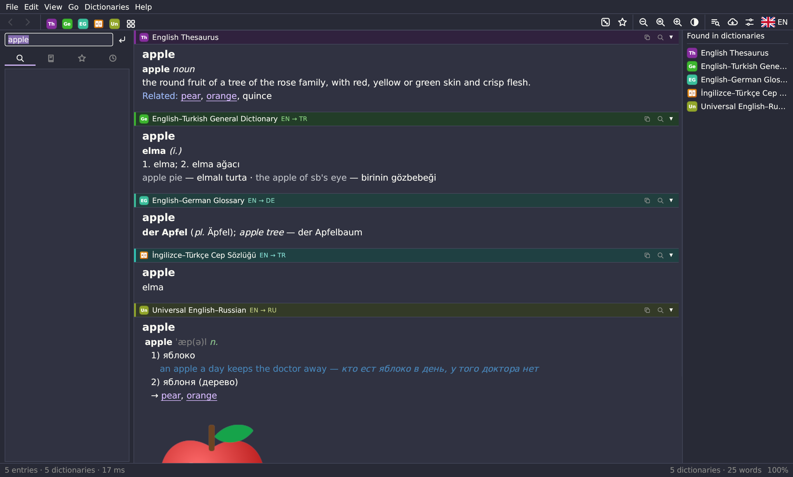
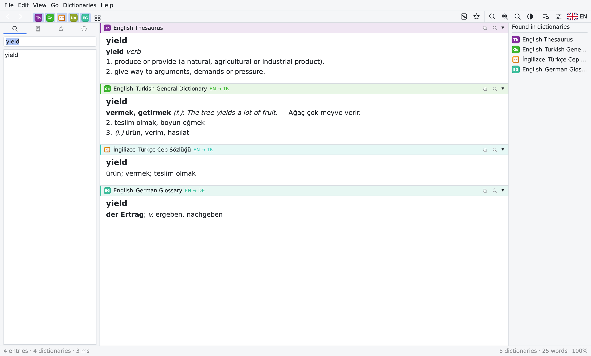
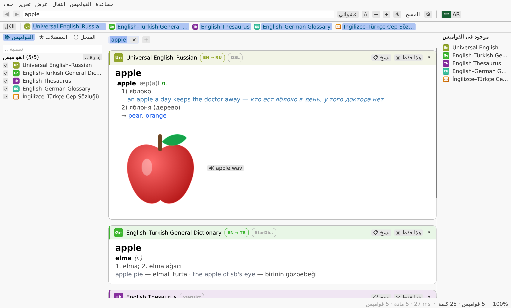

# dictz — Rust edition

[](https://crates.io/crates/dictz)
[](https://docs.rs/dictz)
[](https://www.gnu.org/licenses/gpl-3.0)

Cross-platform, multi-format **offline dictionary** — a GoldenDict-style desktop app and library written in Rust.

This is the Rust edition of [dictz](https://github.com/bayramkotan/dictz). The Python edition (`pip install dictz`) has the same features and ships from the same tag with the same version number. Both editions read dictionaries the same way: CI checks it against shared golden files. They also share one data folder (`dictionaries.json`, `settings.json`, `dictz_index.db`, `dictz_history.db`), so dictionaries, history and favorites added in one edition show up in the other.

<p align="center"></p>

<table>
<tr>
<td width="50%"><br><sub><b>Light theme</b> — compact like GoldenDict, one colour per dictionary</sub></td>
<td width="50%"><br><sub><b>25 interface languages</b> — here Arabic, shaped right to left</sub></td>
</tr>
</table>

<sub>The dictionaries in the pictures are small invented samples; dictz ships no dictionary content. The pictures are taken again with `docs/screenshots/shoot_rust.sh`.</sub>

This crate is also the core of the phone app (dictz Mobile, a separate project): built with `default-features = false, features = ["center"]` — no window, but the readers, index, search and the catalog / download queue.

## Install the app

Both commands get installed: **`dictz`** and its short name **`dct`**. They are the same program.

| Platform | From crates.io | Portable, no Rust needed ([latest release](https://github.com/bayramkotan/dictz/releases/latest)) |
|---|---|---|
| 🐧 **Linux** | `sudo apt install build-essential pkg-config libasound2-dev` then `cargo install dictz` | `tar xzf dictz-rs-linux-x86_64.tar.gz` → `./dictz-rs/dct` |
| 🪟 **Windows 10/11** | `cargo install dictz` ([rustup](https://rustup.rs) with the MSVC build tools) | unzip `dictz-rs-windows-x86_64.zip` → `dictz-rs\dictz.exe` (or `dct.exe`) |
| 🍎 **macOS** | `cargo install dictz` | `tar xzf dictz-rs-macos-arm64.tar.gz` → `./dictz-rs/dct` (Apple Silicon) |

ALSA headers on other distros: `alsa-lib-devel` (Fedora), `alsa-lib` (Arch/CachyOS, usually already installed). To build without in-app sound, use `cargo install dictz --no-default-features --features cli,gui,update,scan`; sounds then open in the system player.

Then:

```bash
dct                   # open the window
dct shortcut          # desktop + menu shortcut (Linux .desktop, Windows Desktop + Start menu, macOS ~/Applications/dictz.app)
dct -V                # version (-v, -V, --version, --Version, --VERSION, -version all work)
dct update            # update this copy (crates.io → cargo install, portable → new release binary)
dct doctor            # check the installation
```

The portable builds are unsigned. On Windows, click SmartScreen's **More info → Run anyway**. On macOS, run `xattr -d com.apple.quarantine dictz-rs/dictz` once if Gatekeeper blocks the binary.

The Windows binary is a GUI program, but it attaches to the console when you start it from PowerShell or cmd, so the command line prints normally.

## Features

- **Formats:** StarDict (`.ifo` / `.idx[.gz]` / `.dict[.dz]`, synonyms from `.syn`), ABBYY Lingvo DSL (`.dsl`, `.dsl.dz`) and Babylon (`.bgl`). All three are parsed natively, with no Python and no PyGlossary.
- **25 interface languages** from the flag at the top right (Türkçe, English, Azərbaycan türkcəsi, Deutsch, Русский, العربية, فارسی, 中文, 日本語, 한국어 …); Arabic, Persian and Urdu interface texts are shaped and drawn right to left.
- **Dictionary icons:** a dictionary's own icon (`Name.png` / `.ico` / `.bmp` next to it, or the icon inside a `.bgl`), otherwise a monogram badge in its own colour; every article card shows it with the language pair and format.
- **One Sözlükler window** (Ctrl+M) with seven tabs — Sözlüklerim (drag rows to reorder, on / off, only this, info, reindex, remove from the list or with the files), Klasörler, Katalog, Kaynaklar, İndirmeler, İçe / Dışa aktar, Ayarlar — and one **Sözlükler** menu; Dosya keeps only article, favourites, shortcut and quit.
- **Catalog** (Ctrl+Shift+M): catalog of free dictionaries from many servers (dictz-data, FreeDict, Wiktionary builds, ECDICT, the StarDict archive, the Internet Archive, Telegram) or your own server, folder or link, with each dictionary's **licence**; download queue with pause / resume / retry and resumed partial downloads, checksums, unpacking (zip, tar, tar.gz, tar.xz, tar.bz2 — pure Rust), uninstall, updates, setup export / import, `catalog.json` builder for your own server. Same files and results as the Python edition.
- **Multi-dictionary search** in your own order. Change the order by dragging in the Sözlüklerim tab, the dictionary bar, the found-in panel or the left pane.
- **Fuzzy search:** "did you mean" suggestions, worked out on their own thread (`suggest.rs`) so typing never freezes. The scores are identical to RapidFuzz `fuzz.ratio`, which the Python edition uses.
- **DSL pictures and sounds** are read from `X.dsl.dz.files.zip`, `X.dsl.files.zip`, `X.files.zip` or the same names as folders (any letter case), StarDict's from `res/`. Pictures show inline; sounds play with one click (WAV, MP3, Ogg, FLAC).
- **SQLite FTS5 index:** instant, diacritic-insensitive prefix suggestions.
- **Interface:**
  - search box fixed on top of the side pane with an Enter button (⏎), also while Dictionaries, Favourites or History is open
  - tabs, back/forward, random word, favorites and history (with filters)
  - dictionary bar: click = go to that dictionary's article, Ctrl+click = on / off (off is faded), right click = menu, drag = reorder; the same in the "found in" panel
  - 25 interface languages, picked from the flag at the top right (Arabic, Persian and Urdu are shaped and drawn right to left)
  - collapsible article cards per dictionary: its icon (or monogram badge in its own colour), language pair, format, copy / "only this dictionary" buttons
  - find in page with highlighting, save article as HTML / text
  - background loading with progress; dictionary folders scanned on start
  - 27 themes (the same table as the Python edition: auto, light, dark, Sepya, Solarized, Gruvbox, GitHub, Catppuccin, Rosé Pine, Nord, One, Dracula, Monokai, Tokyo Night, Everforest, high contrast…), accent color, fonts by name or file, zoom, full screen, always on top
  - drag and drop dictionary files onto the window
  - **Dosya → Masaüstü kısayolu oluştur**: desktop and menu shortcut with the dictz icon
  - scan popup: Ctrl+C+C / every copy / selection (Linux) in any program shows the articles next to the mouse; tray icon, global hotkeys (Ctrl+F11, Ctrl+F12, Ctrl+Shift+F11), single instance
  - the same shortcuts as the Python edition (F1 lists them)

## Command line

The same commands, options and output as the Python edition. `dct` is the short name of `dictz`. `dct help` and `dct <command> --help` list everything.

```bash
dictz lookup apple            # articles as text (-d DICT, -p prefix, -f fuzzy, --json, --html)
dictz suggest app             # headwords starting with "app" (+ ≈ fuzzy fill)
dictz fuzzy aple              # "did you mean" with scores
dictz random                  # a random article
dictz shell                   # interactive prompt (:fuzzy, :suggest, :dicts, :random, :q)

dictz add ~/sozlukler -r      # add files or whole folders
dictz dicts                   # table: position, on/off, name, format, words, path
dictz disable "Lingvo"        # names can be partial: enable / disable / remove / info
dictz move "Lingvo" top       # up / down / top / bottom / position
dictz info En-Tr.dsl          # metadata of a dictionary or a file
dictz reindex                 # rebuild the search index
dictz scan ~/Downloads --add  # find dictionary files, add the new ones
dictz dump En-Tr.dsl -F txt   # export as tsv / json / txt

dictz history  /  dictz favorites add WORD
dictz config list             # every setting with its value, range and description
dictz config set article.font_size 18
dictz config export my.json   # import / reset / path / get
dictz dicts --export list.csv     # the list with licences (csv / json / txt)
dictz sources                 # Dictionary Center servers: add / edit / remove / enable / disable / default / up / down / refresh / export / import / reset
dictz catalog en --to tr      # search the catalog (--license open|free|unknown|nonfree, --format, --supported); show / languages / updates
dictz install ID|NAME|URL     # download, check, unpack, add  ·  dictz uninstall ID  ·  dictz downloads
dictz licenses                # the licence table
dictz catalog build FOLDER --base-url URL   # catalog.json for your own server  ·  dictz catalog check FILE|URL
dictz setup export setup.zip  # whole setup (list, settings, sources, history, files)  ·  import / show
dictz paths  /  dictz doctor  /  dictz selftest
dictz update --check          # crates.io or GitHub release, depending on how it was installed
dictz shortcut [--remove]     # desktop + menu shortcut (--desktop-only, --menu-only)
dictz show                    # bring the running window to the front
dictz popup [WORD]            # scan popup in the running dictz (no WORD = clipboard)
dictz watch on|off|toggle|status   # clipboard / selection scanning
eval "$(dct completion bash)"     # also zsh, fish, powershell — completes both dictz and dct
```

Global options: `--data-dir DIR` (or `DICTZ_DATA_DIR`), `--no-color` (or `NO_COLOR`), `-V` / `--version` (every spelling: `-v`, `--Version`, `-version`…).

## Settings

90 settings in 10 pages (general, appearance, article, search, scan popup, global hotkeys, dictionaries, sound, history, Dictionary Center), stored in `settings.json` in the data folder. The Python edition reads and writes the same file. The dictionary and catalog pages are edited in **Sözlükler → Ayarlar**, the rest in **Düzen → Tercihler** (search box, ↺ per setting, page reset, shortcuts page, advanced page) or with `dictz config`.

## Use as a library

```toml
[dependencies]
dictz = { version = "0.1.0", default-features = false }   # no GUI / audio deps
```

```rust
use dictz::query::QueryManager;

let mut qm = QueryManager::new(None);
qm.add_dictionary("En-Tr.dsl", false)?;
for e in qm.search("apple", true) {
    println!("[{}] {}: {}", e.dictionary_id, e.headword, e.definition);
}
for (word, score) in qm.fuzzy("aple", 5, 60.0) {
    println!("did you mean {word}? ({score:.0}%)");
}
```

| Module | What it does |
|---|---|
| `stardict`, `dsl`, `babylon` | format parsers (all implement `Dictionary`) |
| `query` | lookups across dictionaries, suggestions, fuzzy matching, ordering |
| `index` / `history` | SQLite FTS5 index; history and favorites (same schema as the Python edition) |
| `registry` | the shared `dictionaries.json` dictionary list (order, on/off, unique names, path identity) |
| `articles` | article stores `articles/<id>.db`: a dictionary is parsed once, later starts read articles on demand |
| `media` | finds pictures and sounds of an article |
| `html` | converts article HTML into styled lines (GUI) or text (CLI) |
| `settings` | the shared `settings.json` schema and `Preferences` |
| `fuzzy` | RapidFuzz-compatible `ratio`, `extract` and `rank` |
| `center` | Dictionary Center: `sources`, `adapters` (every source type), `catalog`, `install` (downloads, checksums, unpacking, queue), `transfer` (setup archive, list export, catalog build / check), `licenses`, `langs` |

## Feature flags

| Flag | Default | Pulls in |
|---|---|---|
| `cli` | on | clap (the `dictz` / `dct` command line; both binaries need it) |
| `gui` | on | eframe/egui, rfd (file dialogs), image |
| `audio` | on | rodio (needs ALSA headers on Linux) |
| `update` | on | ureq, tar (`dictz update`) |
| `center` | on | ureq, tar, regex, sha2, md-5, lzma-rs, bzip2 (pure-Rust backend) — the Dictionary Center; `cli` and `gui` turn it on |
| `scan` | on | arboard, clipboard-master, x11rb, global-hotkey, mouse_position, ksni (Linux tray) / tray-icon (Windows, macOS) — scan popup, global hotkeys, tray icon |

## License

GPL-3.0-or-later © Bayram Kotan
